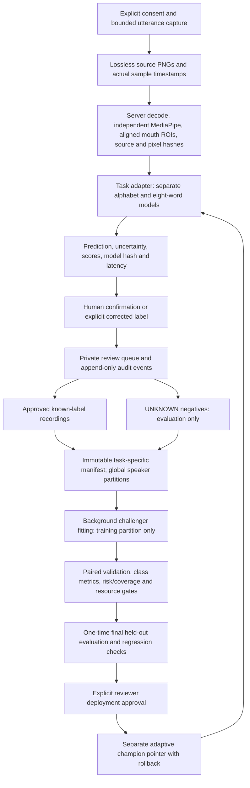

# Adaptive visual speech architecture and candidate audit

2026-11-16, Asia/Calcutta. Read the preserved [reliability results](RELIABILITY_RESULTS.md),
[audit](RELIABILITY_AUDIT.md) and [reproduction guide](RELIABILITY_REPRODUCTION.md).
This phase adds a research feedback lifecycle. It does not establish new recognition accuracy.

The historical `/api/predict` and `/api/predict/word` paths retain their existing selection
and safety rules. The new `/api/adaptive` workflow has its own explicit research champion
pointers. Promotion affects this workflow; it does not silently replace older endpoints.
Legacy four-word, expanded 20-word, LRW500 and Conformer/CTC paths remain separate.

## Existing architecture and candidates

The nested repository was already extensively modified. Earlier source edits, datasets,
reports, checkpoints and policy files were retained. The new implementation is in
`pipeline/adaptive/`, `app/adaptive_routes.py` and `frontend/src/workspace/pages/AdaptiveFeedback.tsx`.
No additional model repository or checkpoint was downloaded.

| Candidate | Local availability and contract | Evidence and decision |
|---|---|---|
| Preserved alphabet CNN-BiLSTM | `models/alphabet_classifier.pt`; 30×1×140×46, grayscale [0,1], A–Z output mapping; 3,664,980 bytes | Retained experimental baseline. Historical 12% is not a reproduced benchmark. No complete, reviewed isolated A–Z data is available for a new experiment. |
| AV-HuBERT + mean/std logistic head | Official encoder at `models/external/avhubert/base_vox_iter5.pt`, 1,240,185,329 bytes; head 66,488 bytes; layer 9, 29×768 features, 96px aligned ROIs → 88px crop, mean .421/std .165 | Existing eight-word champion retained. Historical validation 228/240, macro F1 .949543; historical test 182/192 with original protocol limitations. |
| AV-HuBERT + temporal BiLSTM, 15 frames | Existing source and best/final artifacts in `runs/reliability_20261109/temporal_v2/` | Historical validation 218/240. Rejected previously; no new improvement claimed. |
| AV-HuBERT + temporal BiLSTM, 29 frames | Same frozen visual encoder, projection 64, hidden 32 | Historical validation 215/240. Rejected previously. |
| Publisher LRW DC-TCN | `external/lrw_tcn_reference` and `models/external/lrw_tcn/resnet18_dctcn_video.pth` exist; distinct publisher full-face/boundary preprocessing and ordered LRW vocabulary | Keep its existing independent route. Its vocabulary and preprocessing are not interchangeable with this eight-word head. No fair new feedback-domain evaluation exists. |
| MuAViC reference | Local reference source exists; separate architecture/data/license | No compatible audited adapter/weights/training protocol established here. Not merged. |

Fresh file presence, SHA-256 and byte sizes are in `.qa/adaptive_20261116/final_audit/artifact_audit.json`.
Historical candidate accuracy, per-class reports and confusion matrices remain in their original
run directories. Historical CPU comparison is in `.qa/reliability_20261109/cpu_benchmark_controlled.json`;
the fresh single-replay adapter probe has a different scope and cannot establish a speed change.
Generalization for feedback-trained candidates is unmeasured until a genuine version is collected.

## License and compatibility findings

The checked-in AV-HuBERT license grants non-commercial research use, with additional conditions.
The [official AV-HuBERT license](https://github.com/facebookresearch/av_hubert/blob/main/LICENSE)
was checked alongside `external/av_hubert/LICENSE`. This is not an unrestricted commercial-use grant.
The [DC-TCN source license](https://github.com/mpc001/Lipreading_using_Temporal_Convolutional_Networks/blob/master/LICENSE)
contains BSD-style redistribution conditions. Source permission alone does not establish rights for
every downloaded checkpoint or training dataset. MuAViC's local license is CC BY-NC 4.0.
No additional fine-tuning or redistribution permission is assumed for those candidates.

The preserved alphabet checkpoint uses PyTorch and strict state-key/geometry checks.
AV-HuBERT uses its existing Fairseq source, CPU environment and compatibility patch. The ordinary
word-test environment currently cannot import MediaPipe because Application Control blocks a
Matplotlib DLL; the existing `.venv-avhubert-cpu` imports and runs tracking successfully.
No Windows policy was changed. CPU model extraction remains frozen; no encoder fine-tuning,
quantization or model enlargement was performed.

## Evidence and validation boundaries

The browser captures a bounded video-only MediaRecorder clip and an ordered lossless PNG sequence
of sampled full camera frames. The original WebM/MP4 bytes are retained unchanged beside the PNGs
and timestamps in the private ZIP. The server decodes every video frame, checks bounded length and
geometry, and hashes the original clip. The app provides native video replay and a frame timeline.
Frame-only sources remain accepted for backward compatibility and are explicitly identified by
missing original-video metadata. Native video capture needs a supported MediaRecorder browser.
The PNG sample rate and the video's reported container rate are distinct; neither is advertised
as measured sensor-native FPS. Imported files are replayed into a new bounded video-only recording;
the full unbounded imported container is not uploaded. Source PNGs preserve every captured sampled
pixel even though MediaRecorder's video codec may be lossy. Audio absence is a browser declaration,
not server audio-track/device attestation.

Independent server tracking requires exactly one face per sampled PNG frame, records landmarks and crop
transforms, and rejects out-of-image mouth crops. It measures lighting/contrast and motion.
Landmark presence does not prove an unobstructed mouth, correct utterance boundaries, genuine
speaker identity or a correct human annotation. Occlusion remains explicitly `not_measured`.
Low-quality captures are quarantined; missing/corrupt source or tracking failures receive HTTP 422
without entering an approved dataset. No camera/device attestation is claimed.

The model registry stores task, ordered labels, input/preprocessing specs, checkpoint identity,
dataset version, training configuration, reports and resource measurements. The baseline alphabet
training configuration/report remains null where trustworthy historical provenance is absent.
New word heads use genuine approved training sequences, training-only StandardScaler and a fixed
logistic classifier configuration. New alphabet candidates use the preserved CNN-BiLSTM, fixed
partitions, AdamW, ten-epoch maximum and validation-loss early stopping. Neither training adapter
opens held-out feature values during selection. Unsupported expanded labels block eight-word fitting.

Validation promotion requires strictly better top-1, non-decreasing macro F1, no class F1 drop
over .05, CPU time ≤1500ms, process memory ≤2GiB and head artifact ≤2GiB. At least 20 reviewed
validation negatives are required and false acceptance must not rise by more than .02. These
are fixed research defaults, visible in the comparison report, not an established clinical or
production standard. Resource timing scopes differ by task and are saved explicitly.
Word coverage uses the fixed recorded gate plus temporal agreement; risk/coverage ranks raw scores.

Final held-out evaluation is separately claimed once before reading test values. It runs regression
checks and saves actual inference/shape evidence. Deployment additionally requires complete final
evidence, at least 20 held-out negatives, unchanged hashes, unwithdrawn data, unchanged champion
and an explicit reviewer action. Test accuracy does not choose a challenger. The lossless-source
protocol and identities still require human review; structural eligibility is not sample sufficiency.
