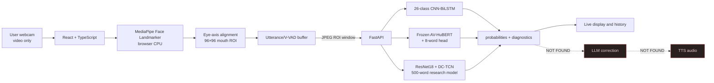
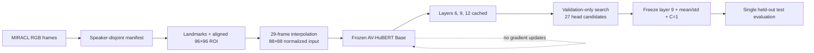
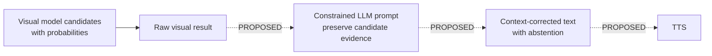

# Lip-Reading Complete Technical Documentation for IEEE Preparation

**Audited project:** LipNet-Alphabet / LipNet-AI  
**Audit date:** 30 October 2026 (Asia/Calcutta)  
**Proposed project title supplied by the author:** *Context-Aware Lip Reading and Speech Generation Using Deep Learning and Generative AI*  
**Evidence rule:** every statement below is tied to current source code, a local artifact, a recorded experiment, or is explicitly marked as proposed or unavailable.

> **Title warning.** The current repository contains visual speech recognition, preprocessing, evaluation, APIs, and a web interface. It contains no executable large-language-model (LLM) integration and no executable text-to-speech (TTS) system. Therefore, the supplied title currently overstates the implementation. An evidence-compatible title is **“Evidence-Aware Visual Speech Recognition with Frozen AV-HuBERT Features and CPU Research Deployment.”** “Context-Aware” and “Speech Generation Using Generative AI” should remain future work until an LLM/TTS implementation and controlled evaluation exist.

## 1. Status vocabulary used in this document

| Status | Meaning |
|---|---|
| **IMPLEMENTED** | Executable source code exists in the repository. |
| **TRAINED** | A loadable learned checkpoint exists with identifiable task geometry. |
| **FINE-TUNED** | Pretrained weights were unfrozen and updated on downstream data. |
| **CONFIGURED** | Code/configuration exists, but no completed trained artifact was verified. |
| **MEASURED** | A result is present in an experiment artifact or was reproduced during this audit. |
| **CALCULATED** | Derived directly from inspected tensors, files, or recorded counts. |
| **PROPOSED** | Recommended future work; not part of the current implementation. |
| **NOT FOUND** | No supporting executable code or artifact was found. |

The project is not one model with one accuracy. It contains separate tasks and artifacts:

1. **Isolated alphabet classification:** 26-way CNN–BiLSTM, one label per clip/window.
2. **Eight-class isolated whole-word recognition:** frozen AV-HuBERT features plus a supervised linear head.
3. **500-class isolated whole-word recognition:** publisher ResNet18 + Dense Temporal Convolutional Network (DC-TCN), integrated as a separate research model.
4. **Character-sequence CTC research path:** appearance/geometry/motion features, a Conformer encoder, CTC heads and greedy decoding; implemented/configured but without a verified trained active decoder checkpoint.
5. **GRID letter-slot experiments:** labels the fourth token of constrained GRID sentences. This is neither free-speech sentence recognition nor general word recognition.

## 2. Audit scope and reproducibility boundary

The recursive inventory enumerated **166,607 files**. Virtual environments, `node_modules`, `.git`, and large generated-data trees were inventoried but not treated as hand-written source. **386 project source/configuration files** were read in full; no Jupyter notebooks were found. The audit covered Python and TypeScript source, model definitions, checkpoints, JSON/YAML configuration, manifests, recorded metrics, acquisition records, tests, frontend routes, backend endpoints, and documentation. The inventory program and output are `.qa/ieee_document_inventory.py` and `.qa/ieee_document_inventory.json`; checkpoint and media probes are in `.qa/ieee_model_metadata.json`, `.qa/ieee_encoder_structure.json`, `.qa/ieee_data_snapshot.json`, and `.qa/ieee_runtime_versions.json`.

No checkpoint was overwritten, no backend selection was changed, no dependency was installed, and no expensive training run was started during this audit. No credential values are reproduced. Generated reports were cross-checked against primary model artifacts because some repository documents are stale.

Fresh audit checks:

```text
.\.venv\Scripts\python.exe -m pytest -q \
  tests/test_phase5_ctc.py tests/test_phase5_vocab_targets.py \
  tests/test_phase5_metrics_dataset.py tests/test_lrw_vocab.py
Result: 44 passed in 7.25 s

npm run test:live
Result: 14 passed, 4 failed
```

The four current frontend failures are all in `frontend/tests/word-consensus.test.mjs`. The current `WordConsensus.update()` assigns the candidate and utterance before testing whether they changed, then returns true on the first non-null window (`frontend/src/live-demo/wordConsensus.ts:13-22`). The failing expectations require two consistent accepted windows, rejection of uncertain outputs, reset after a changed candidate, and reset for a new utterance. This is a **current regression**. Earlier logs that report all live tests passing describe an earlier source state and must not be presented as current verification. The audit documents the fault without modifying the source, as requested.

A prior full Python regression log, `.qa/expanded-word-python-tests.txt`, records **499 passed and 4 skipped in 73.98 s**. It is useful historical evidence, but it was not rerun against the final current working tree during this audit.

## 3. Executive technical verdict

| Claim | Audit verdict | Evidence |
|---|---|---|
| The repository performs isolated A–Z classification | **TRAINED / MEASURED** | `models/alphabet_classifier.pt`; `models/alphabet_model.py:25-75`; `models/training_summary.json` |
| The active alphabet model performs CTC sentence decoding | **False** | It returns one 26-way output from the final BiLSTM time step; `models/alphabet_model.py:73-75` |
| A measured eight-word model exists | **TRAINED / MEASURED** | `runs/word_accuracy/avhubert_miracl8_v1/head.pt`; 182/192 held-out clips |
| AV-HuBERT was fine-tuned end to end | **False** | Encoder is frozen; only a logistic head is fitted. This is transfer learning / linear probing. |
| A genuine 500-class model exists and loads | **TRAINED / SMOKE-TESTED** | Publisher checkpoint `models/external/lrw_tcn/resnet18_dctcn_video.pth`; strict 500-logit load |
| Local 500-class LRW accuracy is known | **False** | Authorized complete LRW corpus is absent; one genuine public clip is only a smoke test. |
| Full GRID data are locally available | **True** | 33 available speakers, 33,000 videos, 32,891 usable pairs |
| GRID availability proves a sentence model exists | **False** | No trained visual-only sentence decoder checkpoint was verified. |
| CTC loss and greedy decoding are implemented | **IMPLEMENTED / TESTED** | `alphabet/losses.py`, `alphabet/decoding.py`; targeted tests pass |
| A trained CTC character model is deployed | **NOT FOUND** | No matching trained active checkpoint or prediction endpoint |
| LLM context correction is integrated | **NOT FOUND** | No provider SDK, model identifier, prompt, request path, or correction evaluation |
| TTS speech generation is integrated | **NOT FOUND** | No executable engine, voice, waveform generation, audio endpoint, or latency record |

## 4. Software and deployment architecture

### 4.1 Implemented runtime

The frontend is React 18 + TypeScript + Vite. It requests a video-only webcam stream at ideal 960×540 and 15 FPS, capped at 24 FPS (`frontend/src/live-demo/useWebcam.ts:27-30`). MediaPipe Face Landmarker runs in browser `VIDEO` mode on the CPU with up to two faces (`frontend/src/live-demo/useLandmarker.ts:17-20`). The browser aligns/crops the mouth, accumulates a temporal buffer, JPEG-encodes mouth ROIs, and sends bounded windows to FastAPI.

Audited frontend versions are Node 24.22.1, npm 11.19.1, React/React DOM 18.3.1, TypeScript 5.6.x, Vite 5.4.10, MediaPipe Tasks Vision 0.10.14, GSAP 3.12.5, Three.js 0.185.1, and KaTeX 0.19.1 (`frontend/package.json`). The Python project declares PyTorch ≥2.2, torchvision ≥0.17, OpenCV ≥4.8, MediaPipe ≥0.10, FastAPI ≥0.115, and Uvicorn ≥0.30 (`pyproject.toml:13-20`). Exact versions in the verified AV-HuBERT environment are reported in Section 13.3; environment-specific versions should be cited instead of minimum constraints when reproducing the experiment.

FastAPI exposes separate endpoints:

| Endpoint | Task | Model selection |
|---|---|---|
| `POST /api/predict` | 26-class isolated alphabet | `LIPNET_MODEL_BACKEND` |
| `GET /api/word/health` | Eight-word service readiness | `LIPNET_WORD_BACKEND` |
| `POST /api/predict/word` | Legacy or AV-HuBERT eight-word model | `LIPNET_WORD_BACKEND=avhubert` selects the measured head |
| `GET /api/word/lrw500/health` | Publisher 500-word readiness | separate lazy-loaded service |
| `POST /api/predict/word/lrw500` | Publisher 500-word inference | separate service and CPU lock |
| `WS /ws/inference` | Lifecycle/readiness channel | prediction remains on bounded HTTP windows |

Route definitions are at `app/main.py:117-148`, `app/main.py:281-319`, `app/main.py:322-359`, and `app/main.py:365-423`. A nonblocking shared CPU lock returns HTTP 429 when word inference is already in progress (`app/main.py:301-319`). Input validation can return 422; model unavailability returns 503.



### 4.2 Model-level architecture summary

```mermaid
flowchart TB
    subgraph Alphabet[Deployed alphabet classifier]
      A0[30 × 1 × 140 × 46] --> A1[Conv2D-BN-ReLU 16]
      A1 --> A2[Conv2D-BN-ReLU 32 + max-pool]
      A2 --> A3[Conv2D-BN-ReLU 64 + max-pool]
      A3 --> A4[Adaptive pool 4×4]
      A4 --> A5[BiLSTM hidden 96]
      A5 --> A6[Last time step → FC 128 → 26 logits]
    end
    subgraph MIRACL8[Measured eight-word transfer model]
      M0[29 × 1 × 88 × 88] --> M1[Frozen AV-HuBERT Base]
      M1 --> M2[Layer 9: 29 × 768]
      M2 --> M3[Temporal mean + std: 1536]
      M3 --> M4[StandardScaler]
      M4 --> M5[8-way logistic head]
    end
    subgraph LRW500[Publisher 500-word model]
      L0[1 × T × 88 × 88] --> L1[3D frontend]
      L1 --> L2[ResNet18 visual trunk]
      L2 --> L3[Dense DC-TCN]
      L3 --> L4[500 logits]
    end
```



## 5. Video processing and computer vision

### 5.1 Measured source media

| Source sample | Resolution | FPS | Frames | Duration | Interpretation |
|---|---:|---:|---:|---:|---|
| GRID `s1/bbaf2n.mpg` | 360×288 | 25 | 75 | 3.00 s | Genuine full GRID sentence video |
| Oxford public `AFTERNOON.mp4` | 256×256 | 25 | 29 | 1.16 s | Genuine public LRW example |
| Local `data/lrw/...` fixture | 46×140 | 25 | 29 | 1.16 s | Development fixture; not genuine LRW evaluation data |
| MIRACL RGB frames | 640×480 | **unknown in manifest** | image sequence | not asserted | Genuine author RGB frames; native FPS is not recorded |

These values were decoded during the audit and are stored in `.qa/ieee_data_snapshot.json`. The 45 local `data/lrw` MP4 files have only **one distinct byte hash** across train/valid/test; they cannot support a recognition claim.

### 5.2 Face and mouth localization

The browser uses MediaPipe Face Landmarker. The live implementation measures mouth openness using inner upper/lower lip landmarks normalized by inner-mouth width (`frontend/src/live-demo/mouthUtils.ts:31-37`). `mouthAlignment()` converts normalized landmarks to pixel coordinates, estimates orientation, and creates a mouth-centered square using default margin 2.2 (`frontend/src/live-demo/mouthUtils.ts:39-80`). The capture canvas is 96×96 (`frontend/src/live-demo/useDemoPipeline.ts:82`).

The Python AV-HuBERT path uses measured face landmarks, eye-axis rotation, a mouth-centered 96×96 grayscale crop, linear temporal interpolation to 29 frames, and the checkpoint’s center crop to 88×88. It scales pixels to [0,1] and normalizes with mean 0.421 and standard deviation 0.165. `AVHubertLoader.prepare_rois()` validates input geometry (`pipeline/avhubert/loader.py:110-147`), and `encode_frames()` calls the official video-only downstream path `extract_finetune(..., audio=None, mask=False)` (`pipeline/avhubert/loader.py:149-169`).

The publisher LRW path estimates a similarity transform from measured landmarks to a stored 68-point mean face, uses LMEDS fitting, warps to 256×256, crops a 96×96 mouth region, then center-crops to 88×88. It resamples by timestamps to 25 Hz without forcing every capture to 29 frames. Webcam input must contain 12–76 frames, one face, 0.32–3.0 seconds at ≥10 Hz, no gap over 160 ms, and sufficient mouth motion (`pipeline/lrw_tcn/preprocessing.py:21-94`). This implementation approximates the publisher alignment with MediaPipe landmark correspondences; it is not claimed to reproduce the publisher’s private LRW preprocessing exactly.

### 5.3 Temporal buffering and stabilization

For alphabet and eight-word modes, the live sequence uses maximum 29 frames, minimum 8 frames, and inference stride 4 (`frontend/src/live-demo/stabilization.ts:3`). The activity detector uses mouth-aperture range and motion rather than a static open mouth. Recorded project settings are minimum aperture range 0.045, minimum recent motion energy 0.008, a 350 ms hold, and a 29-frame window. The probability stabilizer applies an exponential moving average with α=0.6 and normally requires two consistent windows (`frontend/src/live-demo/stabilization.ts:27-61`).

However, whole-word publication currently also passes through the regressed `WordConsensus` logic described in Section 2. Consequently, current live confirmation behavior is not verified even though the underlying model evaluation remains valid.

### 5.4 Training augmentation

The frozen AV-HuBERT feature/head workflow supports coherent sequence-level augmentation: spatial crop jitter up to ±3 pixels, contrast 0.8–1.2, brightness shift ±0.1, and a contiguous 2–3-frame temporal mask. Augmented copies are restricted to training. The measured MIRACL eight-word run used the prepared feature protocol recorded under `runs/word_accuracy/avhubert_miracl8_v1/`; augmentation must not be inferred beyond the recorded run configuration.

The experimental alphabet configuration enables spatial/photometric/temporal augmentation, but a completed matching CTC checkpoint was not found. Configuration is not evidence of use in a trained result.

## 6. Deep-learning models and checkpoints

### 6.1 Checkpoint capability table

| Mode | Architecture | Output | Checkpoint | Parameters | Verified capability | Limitation |
|---|---|---:|---|---:|---|---|
| Alphabet | 2D CNN + one-layer BiLSTM | 26 | `models/alphabet_classifier.pt` | 913,274 trainable | Loads and returns one A–Z distribution | Isolated class only; 12% recorded test accuracy |
| MIRACL eight words | Frozen AV-HuBERT Base + scaler + logistic head | 8 | encoder + `runs/word_accuracy/avhubert_miracl8_v1/head.pt` | 103,330,280 frozen encoder; 12,296 head coefficients/biases | 94.79% on 192 specified clips | Eight words, three test speakers; no physical-webcam accuracy |
| Publisher LRW | 3D frontend + ResNet18 + DC-TCN | 500 | `models/external/lrw_tcn/resnet18_dctcn_video.pth` | 52,548,532 | Strict load; correct one-clip `AFTERNOON` smoke | No full local authorized LRW evaluation |
| Scratch eight-word baseline | 3D CNN + two-layer BiGRU | 8 | `runs/multidataset/miracl8_cpu_v2/best.pt` | 84,048 | Paired baseline on same 192 source clips | 12.50%; preserved comparator |
| Experimental character sequence | fused visual features + 4-block Conformer + CTC | 27 incl. blank | no verified trained active checkpoint | 3,523,803 calculated | Forward/loss/greedy utilities tested | Not deployed; no measured recognition accuracy |
| Legacy mock 500-way artifact | development classifier | 500 | `runs/finetune/lrw_500words/*` | about 0.975M state elements | Synthetic plumbing only | Must not be called genuine LRW training or fine-tuning |

### 6.2 Deployed 26-class alphabet CNN–BiLSTM

The checkpoint configuration is `num_classes=26`, `T=30`, `H=140`, `W=46`. The model applies the same 2D CNN to each grayscale frame:

1. Conv2D 1→16, 3×3, padding 1; BatchNorm; ReLU; adaptive pool to 4×4.
2. Conv2D 16→32, 3×3; BatchNorm; ReLU; 2×2 max-pool.
3. Conv2D 32→64, 3×3; BatchNorm; ReLU; 2×2 max-pool.
4. Flattened per-frame feature: 64×4×4 = 1,024.
5. One-layer bidirectional LSTM, hidden size 96 per direction.
6. Final time step only: 192→128, ReLU, dropout 0.5, then 128→26 logits.

Source: `models/alphabet_model.py:25-49` and `models/alphabet_model.py:63-75`. Calculated parameter count is **913,274 trainable parameters** plus 227 BatchNorm buffers; the checkpoint contains 913,501 tensor elements including buffers and is 3,664,980 bytes.

The browser may send 8–29 captured JPEG mouth crops. The inference adapter decodes each crop, resizes it to 46×140, linearly resamples the sequence to the checkpoint’s required 30 frames, scales by 1/255, constructs `[1,30,1,140,46]`, and applies softmax to the 26 logits (`app/services/browser_inference.py:116-151`).

The stored training summary reports 800/100/100 train/validation/test samples, 30 epochs, CPU training, 995.22 seconds elapsed, best validation accuracy 20%, test loss 2.9523, and test accuracy **12/100 = 12%** (`models/training_summary.json`). This is the only defensible accuracy claim for that checkpoint. `models/alphabet_arch.txt` describes a larger stale architecture and must not be used; tensor shapes and the current strict-loading definition take precedence.

This model does **not** perform CTC. It selects `x[:, -1, :]` and emits one class distribution (`models/alphabet_model.py:73-75`). Calling it a character-sequence or sentence recognizer would be incorrect.

### 6.3 Experimental multimodal-feature Conformer + CTC

The configured research encoder fuses appearance (96 dimensions), geometry (64), and motion (64) into a gated 192-dimensional feature. `TemporalEncoderConfig` specifies `d_model=192`, four Conformer blocks, four attention heads, feed-forward dimension 768, temporal convolution kernel 7, dropout 0.1, and maximum sequence length 512 (`temporal/encoder.py:35-67`; `configs/alphabet_dataset.yaml:158-162`). Each Conformer block is macaron feed-forward → self-attention → depthwise temporal convolution → feed-forward → normalization (`temporal/encoder.py:313-374`).

`MultiTaskAlphabetModel` attaches a per-time-step letter head with 27 outputs: blank at index 0 plus A–Z (`alphabet/heads.py:27-79`). Calculated size is **3,523,803 parameters**. Optional phone and viseme heads exist but are disabled by default. No matching completed trained checkpoint with evaluation evidence was found; this path is **IMPLEMENTED/CONFIGURED**, not **TRAINED**.

Configured training values are 60 epochs, batch size 8, AdamW, learning rate 3×10⁻⁴, weight decay 0.01, warm-up ratio 0.1, cosine decay to 5% of the base rate, gradient clipping 1.0, AMP disabled, and early-stopping patience 10 (`configs/alphabet_dataset.yaml:209-218`; `alphabet/train.py:353-419`). These values must not be attributed to the deployed alphabet checkpoint.

### 6.4 Scratch eight-word baseline

`pipeline/word_recognition/legacy_word_model.py:11-30` defines three Conv3D blocks (1→8→16→32) with GroupNorm and SiLU, followed by spatial mean pooling, a two-layer bidirectional GRU with hidden size 48 and dropout 0.15, and a 96→8 classifier. Its input is `[B,1,24,64,64]`, and it has **84,048 parameters**.

Its training pipeline uses label-smoothed cross-entropy, AdamW, ReduceLROnPlateau, validation-loss checkpoint selection, and early stopping (`pipeline/word_recognition/train.py:77-196`). The preserved model serves as the before-transfer comparator. It scored **24/192 = 12.50%** when rerun on the same source clips as the AV-HuBERT model, using its own required preprocessing.

### 6.5 Frozen AV-HuBERT eight-word transfer model

The representation model is the official AV-HuBERT Base checkpoint `base_vox_iter5.pt`, SHA-256 `dee8b0651dbea3a21cda0f2c52b956e3a878d5f6ee503d427d6a4044bb95c9cc`. It has **103,330,280 parameters** and is set to evaluation mode with all parameters frozen (`pipeline/avhubert/loader.py:50-96`). The video-only downstream path produces 768-dimensional frame representations.

Features from transformer layers 6, 9, and 12 are extracted once. For each layer, temporal `mean`, `mean_std`, and `temporal3` pooling are evaluated with logistic regularization C∈{0.01,0.1,1}; this makes 27 candidates. Candidate selection uses only the known-word validation split (`pipeline/word_recognition/pretrained.py:208-245`). The selected model is:

- transformer layer 9;
- temporal mean concatenated with temporal standard deviation: 1,536 features;
- training-only `StandardScaler`;
- eight-way scikit-learn logistic regression, C=1, L-BFGS, maximum 600 iterations, balanced class weights;
- 12,296 learned classifier coefficients and biases.

The head is `runs/word_accuracy/avhubert_miracl8_v1/head.pt`, SHA-256 `bc07a9eca0979e556af573a387733396a891fe41faa10715c9f4d323e9c4cc74`. The selection achieved 228/240 = **95.00% validation accuracy**, with usable validation log loss 0.18884.

**Fine-tuning classification:** this experiment is **not end-to-end fine-tuning**. No AV-HuBERT weight is updated. It is frozen pretrained feature extraction followed by supervised linear probing. The word “fine-tuning” should not be used for this run unless qualified as “downstream head training with a frozen encoder.”

### 6.6 Genuine publisher 500-word model

The separate checkpoint `models/external/lrw_tcn/resnet18_dctcn_video.pth` is 210,597,729 bytes, SHA-256 `806ea23bc082a9c8a3c08aafbc1cab0f0f8aaeef70a4c824989ebd17bf245b5f`. It comes from the publisher’s *Lipreading using Temporal Convolutional Networks* code at recorded commit `0cc99fab046bd959578f2baac52e654746da4825`.

The model comprises a Conv3D visual frontend, a video ResNet18 trunk, and a Dense TCN with block layout `[3,3,3,3]`, growth 384, kernels 3/5/7, dilations 1/2/5, reduced size 512, squeeze-excitation enabled, and dropout 0.2 (`pipeline/lrw_tcn/config.json`; `pipeline/lrw_tcn/vendor/model.py:88-163`). It has **52,548,532 parameters**. Its final classifier weight is `[500,1664]`, and the ordered vocabulary contains exactly 500 unique labels (`pipeline/lrw_tcn/inference.py:32-48`).

The strict loader returns 500 probabilities and top five candidates. Default rejection is confidence ≥0.7 and top-one margin ≥0.15, explicitly marked uncalibrated (`pipeline/lrw_tcn/inference.py:50-67`). One genuine public Oxford clip labeled `AFTERNOON` was correctly predicted with confidence 0.95890 and 3.09 s command-level inference time. This is one smoke test, **not** a 500-class accuracy estimate.

### 6.7 Synthetic/mock 500-way artifact

`scripts/train_lrw_500words.py:113-176` now explicitly limits the old workflow to synthetic fixtures. Its one-epoch summaries and low validation results are development plumbing. They are not authorized LRW data, not a real 500-word benchmark, and not evidence that the alphabet model was genuinely fine-tuned for words. The publisher model in Section 6.6 is the only verified genuine 500-output checkpoint.

## 7. Training, transfer learning, and “before versus after”



### 7.1 MIRACL protocol

The complete manifest contains 2,700 rows: 1,200 isolated-word items and 1,500 phrase items from 15 speakers. The eight supported labels are `choose`, `connection`, `hello`, `navigation`, `next`, `previous`, `start`, and `stop`. Two source label families with unresolved naming conflicts were excluded instead of silently renamed.

| Partition | Speakers | Planned/usable word clips | Role |
|---|---|---:|---|
| Train | F01, F02, F04, F05, F06, F07, M01, M02, M04 | 720/704 | Fit scaler and logistic head |
| Validation | F08, F09, M07 | 240/240 | Select layer, pooling, C, and rejection policy |
| Test | F10, F11, M08; repetitions 03–10 | 192/192 | Final known-word evaluation |
| Quarantine | same test speakers; repetitions 01–02 | 48 | Excluded because an earlier pilot observed them |
| Phrase diagnostic | 60 validation + 60 test phrases | 120 | Limited out-of-vocabulary diagnostic only |

Because the earlier pilot observed the final speaker identities, this is a fresh-utterance test on held-out speakers, not a completely untouched population. The limitation is material.

### 7.2 Before and after results

| System | Correct / 192 | Top-1 | Difference |
|---|---:|---:|---:|
| Preserved scratch 3D-CNN + BiGRU | 24 | 12.50% | reference |
| Frozen AV-HuBERT + selected linear head | 182 | 94.79% | +82.29 percentage points |

Both systems were evaluated on the same 192 source clip identifiers, while each used its own required spatial/temporal preprocessing. The paired record is `runs/word_accuracy/avhubert_miracl8_v1/paired_comparison.json`. This is a meaningful system comparison but not a controlled single-variable ablation: the pretrained pipeline has a different representation, preprocessing, and larger effective training set.

No encoder loss curve exists because the encoder was not optimized. Logistic optimization convergence and the 27 validation candidate records are in `selection.json`; presenting a fabricated epoch-by-epoch “fine-tuning curve” would be incorrect. The existing `submission_package/Fine_Tuning_Before_and_After.pdf` should therefore be interpreted using the same frozen-feature terminology.

### 7.3 Checkpoint and selection controls

- Test predictions did not select the feature layer, pooling scheme, or classifier C.
- Encoder/preprocessing/head fingerprints are stored and checked on loading.
- Source IDs and test outputs are retained in `test_predictions.jsonl`.
- The confusion matrix and per-class counts are retained in CSV/PNG/HTML/JSON forms.
- The measured evaluation originally used rejection threshold 0.95 and margin 0.20, producing 137/192 accepted known words, all 137 correct, and 8/60 falsely accepted test phrases.
- The current `rejection_policy.json` contains 0.60/0.10 and describes webcam calibration, but no corresponding physical-webcam evaluation was found. Do not attach the older accepted-coverage result to the newer thresholds.

## 8. Datasets and task boundaries

### 8.1 Dataset table

| Dataset/artifact | Local status | Contents | Actual use | Critical limitation |
|---|---|---|---|---|
| MIRACL-VC1 | Available | 15 speakers, 1,200 isolated words + 1,500 phrases, 640×480 RGB frames | Measured eight-word experiment | Eight resolved labels; native FPS absent from manifest |
| GRID | Available | 33 speakers with video, 33,000 source clips, 32,891 usable | Letter-slot manifests and small word experiments | Constrained grammar; no trained sentence decoder |
| LRW official corpus | Absent | Would provide up to 1,000 clips for each of 500 words | Not locally evaluated | Requires BBC/Oxford agreement and authorized access |
| Public Oxford example | Available | One genuine `AFTERNOON` clip | Publisher-model smoke test | One clip cannot estimate accuracy |
| `data/lrw` fixtures | Available | 45 duplicate fixture videos | Development tests only | One unique video hash; invalid for evaluation |

### 8.2 GRID corpus

The local GRID acquisition contains all 33 speakers for whom the publisher provides video: s1–s20 and s22–s34. Speaker s21 is unavailable from the publisher. There are 33,000 source videos, of which 32,891 video/annotation pairs passed the local decoding and annotation checks; 109 were excluded for premature decoding termination.

The frozen speaker-disjoint split is:

- train: 23 speakers, 22,891 clips;
- validation: 5 speakers, 5,000 clips;
- test: 5 speakers, 5,000 clips.

The derived letter task selects the fourth content token from each six-token GRID sentence. Its 25 classes are A–V plus X, Y, Z; **W is absent**. Each validation/test class has 200 examples. A head trained on this manifest would be a 25-class coarticulated letter-slot experiment and would be incompatible with the 26-class live A–Z endpoint.

GRID grammar comprises command, color, preposition, letter, digit, and adverb slots. Word alignments use 25,000 timestamp units per second. Dataset availability does not imply sentence-recognition capability. `pipeline/sequence_recognition/ctc_decoder.py:80-93` deliberately refuses to manufacture continuous predictions without a trained visual-only decoder checkpoint.

### 8.3 LRW corpus boundary

`data/vocab.txt` and `pipeline/lrw_tcn/vocabulary.txt` contain 500 ordered labels, but a vocabulary file is not a dataset. The complete authorized LRW videos, official splits, and publisher-equivalent alignment are absent. The official LRW specification describes 29-frame, 1.16-second clips at 25 FPS with 500 target words and date-based splits. Any future acquisition must use authorized links received through the applicable BBC Research & Development agreement; no access control should be bypassed.

## 9. CTC recognition analysis

### 9.1 What is implemented

The experimental letter vocabulary reserves index 0 for CTC blank and indices 1–26 for A–Z. `alphabet/losses.py:28-75` converts `[B,T,V]` logits to float32 log probabilities `[T,B,V]`, validates sequence lengths and nonblank targets, then calls `torch.nn.functional.ctc_loss` with blank 0 and `zero_infinity=True`. The loss uses explicit input lengths so padding is ignored.

`alphabet/decoding.py:41-112` implements canonical greedy decoding: per-frame argmax, collapse adjacent repetitions, then remove blank. Tests cover repeated letters and blank separation. Beam search is **not implemented**, and no language-model shallow fusion is connected. `pipeline/sequence_recognition/ctc_decoder.py` includes edit-distance, WER, and CER utilities, but these utilities do not constitute a recognition model.

### 9.2 What is not verified

- No trained active Conformer/CTC checkpoint was found.
- No held-out CTC CER/WER is available.
- No character beam-search decoder is available.
- No lexicon or language model is integrated.
- No continuous GRID sentence prediction endpoint is available.

Therefore, CTC should appear in a paper as an implemented research path or proposed sequence extension, not as the source of current deployed accuracy.

## 10. Generative AI / LLM integration

**Status: NOT FOUND.** Recursive source inspection found no executable provider SDK call, model identifier, prompt template, API key variable, context-correction endpoint, response parser, retry policy, token accounting, or LLM evaluation. The current visual models output letters or fixed-vocabulary words directly.

Consequently, the following requested fields have no current value:

| Field | Current evidence |
|---|---|
| Provider and model/version | Not found |
| API configuration | Not found |
| Prompt template | Not found |
| Temperature / top-p / token limit | Not found |
| Input/output schema | Not found |
| Retry/error handling | Not found |
| Token use and cost | Not measured |
| Correction latency | Not measured |
| Raw-vs-corrected accuracy/WER | Not evaluated |



A defensible future LLM experiment must retain the raw result, pass an n-best list with probabilities, prohibit invention outside an explicit vocabulary or grammar where appropriate, support abstention, and report both correction gains and harmful overcorrections. LLM text correction would be a linguistic postprocessor, not improved visual recognition. It should be evaluated against raw model output on a locked test set.

## 11. Text-to-speech

**Status: NOT FOUND.** There is no executable TTS engine/model, voice, language selection, sample rate, pitch/rate setting, audio codec, waveform file, browser speech-synthesis call, audio response endpoint, or measured generation latency. A label reading “Audio Feedback/TTS” in a generated submission illustration is aspirational documentation, not an implementation.

Until TTS exists, the system endpoint is visual input → textual class output. The paper must not claim speech generation, audio synthesis, or end-to-end lip-reading-to-speech latency.

## 12. Mathematical formulation

This section labels each equation as implemented or theoretical support.

### 12.1 Pixel normalization — implemented

For AV-HuBERT and the publisher LRW model:

\[
x'_{tij}=\frac{x_{tij}/255-\mu}{\sigma},\qquad \mu=0.421,\quad \sigma=0.165,
\]

where \(x_{tij}\) is the grayscale pixel at time \(t\), row \(i\), column \(j\). The AV-HuBERT tensor has shape `[B,1,T,88,88]`. The deployed alphabet model uses grayscale tensors shaped `[B,T,1,140,46]` after scaling according to its browser adapter.

### 12.2 Affine/similarity alignment — implemented

Given measured landmark correspondences \(p_i\) and canonical points \(q_i\), alignment estimates transform \(A\) and translation \(b\):

\[
(A^*,b^*)=\arg\min_{A,b}\sum_i \rho\!\left(\|Ap_i+b-q_i\|_2^2\right),
\]

where \(\rho\) is the robust estimator used by LMEDS in the LRW path. The browser and AV-HuBERT path use eye-axis orientation and mouth-center/width geometry.

### 12.3 Convolution — implemented

For an output channel \(c\):

\[
y_{t,c,i,j}=\phi\!\left(b_c+\sum_{c',\tau,u,v}W_{c,c',\tau,u,v}
x_{t+\tau,c',i+u,j+v}\right),
\]

where temporal extent \(\tau\) is omitted for 2D convolution and present for Conv3D. \(\phi\) is ReLU in the alphabet CNN and SiLU/Swish in relevant word models.

### 12.4 LSTM/BiLSTM — theoretical expansion of an implemented PyTorch layer

The deployed alphabet model uses `nn.LSTM`; the gate equations are:

\[
\begin{aligned}
i_t&=\sigma(W_i x_t+U_i h_{t-1}+b_i), &
f_t&=\sigma(W_f x_t+U_f h_{t-1}+b_f),\\
o_t&=\sigma(W_o x_t+U_o h_{t-1}+b_o), &
\tilde c_t&=\tanh(W_c x_t+U_c h_{t-1}+b_c),\\
c_t&=f_t\odot c_{t-1}+i_t\odot\tilde c_t, &
h_t&=o_t\odot\tanh(c_t).
\end{aligned}
\]

The bidirectional representation is \(h_t=[\overrightarrow h_t;\overleftarrow h_t]\). The implementation takes only \(h_T\) for clip classification.

### 12.5 Softmax and logistic head — implemented

For logits \(z\) over \(K\) classes:

\[
p(y=k\mid x)=\frac{e^{z_k}}{\sum_{j=1}^{K}e^{z_j}}.
\]

For the selected eight-word model, layer-9 features \(H\in\mathbb{R}^{29\times768}\) are pooled as

\[
v=[\operatorname{mean}_t(H);\operatorname{std}_t(H)]\in\mathbb{R}^{1536},
\quad \hat v=(v-\mu_v)/s_v,
\quad p=\operatorname{softmax}(W\hat v+b).
\]

Here \(W\in\mathbb{R}^{8\times1536}\), and the scaler statistics are fitted on training data only.

### 12.6 CTC loss — implemented utility, no verified trained result

For input \(X\), target label sequence \(Y\), and all frame-level paths \(\pi\) that collapse to \(Y\) under mapping \(\mathcal{B}\):

\[
P(Y\mid X)=\sum_{\pi\in\mathcal{B}^{-1}(Y)}\prod_{t=1}^{T}p(\pi_t\mid X),
\qquad
\mathcal{L}_{CTC}=-\log P(Y\mid X).
\]

Greedy decoding computes \(\pi_t^*=\arg\max_k p(k\mid X,t)\), merges adjacent repeats, and removes blank. Beam search is absent.

### 12.7 Exponential moving average — implemented

\[
\bar p_t=\alpha p_t+(1-\alpha)\bar p_{t-1},\qquad \alpha=0.6.
\]

The normal stabilizer requires two consistent top-one windows after smoothing. The separate current whole-word consensus regression prevents claiming this guarantee for the final UI state.

### 12.8 Rejection — implemented, current thresholds not fully validated

An isolated word is accepted when

\[
p_{(1)}\ge\tau\quad\land\quad p_{(1)}-p_{(2)}\ge m,
\]

where \(p_{(1)}\) and \(p_{(2)}\) are the two highest probabilities. Recorded evaluation used \(\tau=0.95,m=0.20\); the current file contains 0.60/0.10 without a new physical-webcam evaluation.

### 12.9 Metrics — implemented in evaluation code

\[
\mathrm{Accuracy}=\frac{N_{correct}}{N},\quad
\mathrm{Precision}_k=\frac{TP_k}{TP_k+FP_k},\quad
\mathrm{Recall}_k=\frac{TP_k}{TP_k+FN_k},
\]

\[
F1_k=\frac{2\,\mathrm{Precision}_k\,\mathrm{Recall}_k}
{\mathrm{Precision}_k+\mathrm{Recall}_k}.
\]

For reference sequence length \(N\), substitutions \(S\), deletions \(D\), and insertions \(I\):

\[
\mathrm{WER}=\frac{S+D+I}{N},\qquad
\mathrm{CER}=\frac{S_c+D_c+I_c}{N_c}.
\]

The reported eight-word “WER” is a single-token substitution rate, not continuous-sentence WER.

### 12.10 Optimization and latency

Logistic-head training minimizes regularized cross-entropy:

\[
\mathcal{J}(W,b)=-\sum_{n=1}^{N}\log p(y_n\mid v_n)+\lambda\|W\|_2^2.
\]

This updates only \(W,b\), not AV-HuBERT. A proposed end-to-end latency decomposition is

\[
T_{e2e}=T_{capture}+T_{landmark}+T_{ROI}+T_{network}+T_{visual\ model}
+T_{LLM}+T_{TTS}.
\]

Only visual-pipeline components have measurements; \(T_{LLM}\) and \(T_{TTS}\) are undefined because those components do not exist.

## 13. Experimental results

### 13.1 Eight-word held-out test

| Metric | Result |
|---|---:|
| Correct / total | 182 / 192 |
| Top-1 accuracy | 94.79% |
| Top-5 accuracy | 99.48% |
| Macro precision | 0.95232 |
| Macro recall | 0.94792 |
| Macro F1 | 0.94668 |
| Single-word substitution rate | 5.21% |

Per-class results:

| Word | Correct/total | Precision | Recall | F1 |
|---|---:|---:|---:|---:|
| choose | 24/24 | 0.9231 | 1.0000 | 0.9600 |
| connection | 23/24 | 0.9583 | 0.9583 | 0.9583 |
| hello | 24/24 | 0.9600 | 1.0000 | 0.9796 |
| navigation | 23/24 | 0.9200 | 0.9583 | 0.9388 |
| next | 22/24 | 1.0000 | 0.9167 | 0.9565 |
| previous | 18/24 | 1.0000 | 0.7500 | 0.8571 |
| start | 24/24 | 0.8571 | 1.0000 | 0.9231 |
| stop | 24/24 | 1.0000 | 1.0000 | 1.0000 |

Four of the six `previous` errors were assigned to `start`. Held-out speaker counts were F10 62/64, F11 57/64, and M08 63/64. Complete results are in `runs/word_accuracy/avhubert_miracl8_v1/evaluation.json`, `test_predictions.jsonl`, `confusion.csv`, `confusion.png`, and `confusion.html`.

### 13.2 Other measured results

| Experiment | Result | Proper interpretation |
|---|---:|---|
| Alphabet CNN–BiLSTM test | 12/100 = 12% | Isolated A–Z checkpoint only |
| Scratch eight-word paired baseline | 24/192 = 12.50% | Same source clips as transfer model |
| GRID four-command experiment | 12/32 = 37.50%, macro F1 0.319, single-word error 62.50% | `bin/lay/place/set`; not sentence recognition |
| Publisher LRW public smoke | 1 `AFTERNOON` clip correct | Load/execution evidence only |
| Seven-source LRW diagnostic | 1/4 known samples correct; top-5 25%; one failed | Too small and only two known classes |
| Real eight-word HTTP smoke | one `connection` clip accepted at 0.99838 | Endpoint execution evidence only |

### 13.3 Runtime and resource measurements

The audited computer is an Intel Core i3-1115G4 (2 physical cores / 4 logical processors), approximately 7.74 GiB RAM, with no CUDA device. The active AV-HuBERT CPU environment uses Python 3.11.9, PyTorch 2.2.2+cpu, OpenCV 4.9.0, NumPy 1.26.4, FastAPI 0.162.0, Uvicorn 0.54.0, and Pydantic 2.14.1. Audit-time free disk space was about 292.4 GiB.

Measured eight-word preparation on one CPU thread:

| Stage | Measurement |
|---|---:|
| Tracking and ROI preparation | 626.28 s |
| AV-HuBERT extraction for 1,256 usable word/phrase clips | 856.29 s |
| Head search/training | 19.29 s |
| Paired 192-clip comparison | 52.03 s |

A separate 500-word two-view HTTP trace recorded roughly 949 ms server latency, 875 ms CPU time, 655 MiB resident memory after inference, and 789 MiB peak memory. It used a genuine clip and returned consistent `AFTERNOON` views, but is not a general latency benchmark. No stable per-frame, LLM, TTS, or complete lip-to-speech latency is available.

## 14. Reliability, inconsistencies, and current blockers

1. **Live word consensus regression:** four fresh frontend tests fail; uncertain or first-window candidates may be published too early. `app/services/pretrained_word_inference.py:47-55` also returns a candidate in `word`/`display_word` even when the model marks it uncertain. Current live behavior must be fixed and retested before a demo reliability claim.
2. **Rejection-policy drift:** the evaluation evidence describes 0.95/0.20, while the current JSON says 0.60/0.10. A new locked evaluation is required for the current policy.
3. **Stale alphabet architecture document:** `models/alphabet_arch.txt` does not match strict checkpoint tensors; use `models/alphabet_model.py` and checkpoint shapes.
4. **Stale dataset reports:** some older reports say MIRACL is unavailable although the current validated manifest and frames exist. Use current manifests/catalogs.
5. **No full LRW data:** the 500-class checkpoint is genuine, but complete local evaluation is blocked by authorized corpus access and faithful alignment validation.
6. **No trained CTC decoder:** CTC code passing tests does not establish sequence recognition.
7. **No LLM or TTS:** the proposed project title and any pipeline diagram must label these as future work.
8. **Webcam domain shift:** the 94.79% result is on prepared MIRACL clips, not physical webcam sessions.
9. **Limited vocabulary:** eight-word accuracy cannot be extrapolated to arbitrary English.
10. **Licensing:** AV-HuBERT, MIRACL, GRID, LRW data, and the publisher model carry their own research-use terms. Successful integration does not grant commercial rights.

## 15. Research gap, contributions, and novelty boundary

### 15.1 Defensible research gap

High-capacity visual speech models often assume GPU resources, controlled datasets, or end-to-end training. Small custom models can be feasible on low-end Windows CPU systems but generalize poorly. The project studies whether a frozen pretrained visual speech encoder, strict dataset provenance, speaker-disjoint evaluation, and a lightweight supervised head can provide useful limited-vocabulary recognition under CPU constraints.

### 15.2 Actual contributions

1. A reproducible Windows CPU pipeline that applies an official frozen AV-HuBERT encoder to measured, aligned mouth ROIs.
2. Validation-only selection across encoder layers, temporal pooling strategies, and linear-head regularization.
3. A paired same-source comparison between a small scratch spatiotemporal model and frozen pretrained features.
4. Artifact fingerprints, source hashes, explicit task vocabularies, and checks that prevent incompatible heads from being activated.
5. Speaker-disjoint acquisition and validation of 32,891 usable GRID clips, kept separate from whole-word tasks.
6. Strict integration of a genuine publisher 500-class architecture/checkpoint with explicit absence of a local full LRW benchmark.
7. A browser/FastAPI research interface with on-device landmarking, activity gating, bounded requests, and multiple isolated recognition modes.

### 15.3 What is not novel

AV-HuBERT, MediaPipe landmarks, CNNs, BiLSTMs, GRUs, Conformers, CTC, logistic regression, DC-TCN, EMA smoothing, and confidence rejection are established methods. The project’s contribution is their evidence-aware integration and evaluation under the stated constraints, not invention of those algorithms.

## 16. IEEE paper-ready section content

### 16.1 Abstract draft

> Visual-only speech recognition is challenging under limited labeled data and CPU-only deployment constraints. This work presents an evidence-aware research pipeline for isolated visual speech recognition that combines landmark-based mouth alignment with frozen AV-HuBERT representations and a lightweight supervised classifier. On an eight-class MIRACL-VC1 protocol containing 192 specified test utterances from three held-out speakers, the selected layer-9 mean-and-standard-deviation head obtained 94.79% top-1 accuracy and 0.9467 macro F1, compared with 12.50% for a preserved scratch 3D-CNN–BiGRU baseline evaluated on the same source clips. The system also integrates, as separate research modes, a 26-class alphabet CNN–BiLSTM and a publisher 500-class ResNet18–DC-TCN checkpoint. Strict artifact fingerprints and task-specific activation checks prevent unsupported cross-task claims. Results are limited to isolated fixed-vocabulary recognition; physical-webcam accuracy, continuous sentence decoding, LLM correction, and text-to-speech generation remain unverified future work.

### 16.2 Keywords

Visual speech recognition; lip reading; AV-HuBERT; transfer learning; frozen feature extraction; isolated word recognition; spatiotemporal learning; CPU inference; MediaPipe; reproducible evaluation.

### 16.3 Introduction content

Explain the visual ambiguity of speech, speaker and imaging variation, and the scarcity of task-specific labeled data. Motivate frozen self-supervised representations as an alternative to training a spatiotemporal network from scratch. State the scope early: isolated letters and words, with the main measured result limited to eight MIRACL labels. Do not imply continuous sentence transcription or synthesized audio.

### 16.4 Literature review anchors

- LipNet established end-to-end sentence-level lip reading with spatiotemporal convolution, recurrent modeling, and CTC.
- AV-HuBERT uses masked self-supervised audiovisual representation learning and provides transferable visual speech features.
- LRW provides a 500-word in-the-wild isolated-word benchmark.
- Martinez et al. use temporal convolutional networks for efficient visual word recognition.
- GRID provides a constrained audiovisual sentence grammar and speaker corpus.

The literature review must separate published benchmark results from this repository’s local results.

### 16.5 Problem statement

Given a silent mouth-region sequence \(X\), predict one label from a fixed vocabulary while operating on CPU hardware and preserving enough provenance to state exactly which checkpoint, preprocessing, split, and metric produced each result. The primary hypothesis is that frozen pretrained visual representations plus a small supervised head outperform a small scratch network under the available labeled-data and compute constraints.

### 16.6 Proposed methodology

Describe landmark detection, eye-axis/mouth canonicalization, 29-frame interpolation, AV-HuBERT normalization, frozen layer extraction, temporal mean/std pooling, StandardScaler, validation-only model selection, and final held-out testing. Present the alphabet and 500-word paths as separate capability studies rather than components of the eight-word score.

### 16.7 Model training and fine-tuning section

Use the heading “Transfer Learning and Downstream Head Training.” State explicitly that AV-HuBERT remained frozen and no end-to-end fine-tuning occurred. Report 103,330,280 non-trainable encoder parameters and 12,296 learned classifier coefficients/biases. Explain the 27 validation candidates and one-time test evaluation. Put true end-to-end fine-tuning in future work.

### 16.8 Experimental setup

Report the exact MIRACL speakers and repetition quarantine from Section 7.1, 96×96 aligned ROIs, 29 frames, 88×88 encoder crop, normalization constants, CPU hardware, software versions, head search space, and tracking failures. Define top-1, top-5, macro F1, and single-token WER. Include checkpoint SHA-256 values.

### 16.9 Results and comparative analysis

Use the tables in Section 13. Make clear that +82.29 percentage points is a full-pipeline paired comparison, not a controlled fine-tuning ablation. Analyze the `previous`→`start` confusion. Report the phrase rejection diagnostic separately from known-word accuracy. Do not merge the alphabet, GRID, eight-word, and 500-word results.

### 16.10 Limitations

Eight resolved words, three test speakers, prior pilot exposure to test speaker identities, unknown native MIRACL FPS, no physical-webcam benchmark, no general isolated-word OOV validation, no continuous decoder, no complete local LRW evaluation, no LLM/TTS, CPU latency, and current live-consensus regression.

### 16.11 Conclusion draft

> Frozen AV-HuBERT representations with a lightweight supervised head substantially outperformed the preserved scratch baseline on the defined eight-word MIRACL protocol while remaining executable on CPU-only Windows hardware. The result demonstrates the value of pretrained visual speech representations for a limited-vocabulary research setting, but it does not establish general English, continuous sentence, or webcam recognition. The repository’s explicit separation of tasks and artifact provenance supports reproducible capability reporting. Future work should repair and recalibrate live consensus, acquire a new untouched speaker evaluation, establish authorized LRW testing, train a genuine character-sequence decoder, and only then evaluate constrained LLM correction and TTS as separate downstream components.

## 17. Required experiments before IEEE submission

- [ ] Repair `WordConsensus` and uncertain-response publication, then obtain a clean current frontend test run.
- [ ] Freeze the final rejection thresholds before testing; rerun known-word coverage and phrase/OOV false-accept evaluation.
- [ ] Record a preregistered physical-webcam dataset with unseen speakers, cameras, lighting, distances, and repeated sessions.
- [ ] Add an untouched speaker population that was never used in pilot work.
- [ ] Report confidence intervals and statistical significance for the paired baseline comparison.
- [ ] Run ablations for AV-HuBERT layer, pooling, scaler, temporal interpolation, alignment, and visual activity gating.
- [ ] Report tracking failure rate as part of end-to-end accuracy, not only classifier accuracy.
- [ ] Calibrate confidence (reliability diagram, expected calibration error) on validation data.
- [ ] Evaluate genuine isolated out-of-vocabulary words, not only multi-word phrases.
- [ ] Obtain authorized LRW data before reporting 500-class local accuracy; verify official split and alignment fidelity.
- [ ] Train and evaluate a genuine character CTC checkpoint before claiming sequence recognition; add beam search only as a separately evaluated method.
- [ ] If LLM correction is added, lock the provider/model/version/prompt and compare raw versus corrected output, including harmful correction rate, latency, tokens, and cost.
- [ ] If TTS is added, record engine/model, voice, language, sample rate, format, rate/pitch, generation latency, and subjective/intelligibility evaluation.
- [ ] Measure cold/warm latency distributions, peak memory, throughput, and end-to-end capture-to-display delay on the target computer.
- [ ] Repeat the complete regression and production frontend build from a clean checkout.
- [ ] Archive environment lock files, Git commit, dataset manifests, licenses, hashes, and exact commands with the submission.
- [ ] Obtain ethics/consent documentation for any newly recorded faces and speech videos.

## 18. Primary source-code and artifact index

| Topic | Exact evidence location |
|---|---|
| Alphabet architecture | `models/alphabet_model.py:25-75` |
| Alphabet checkpoint adapter | `app/services/browser_inference.py` |
| Alphabet recorded metrics | `models/training_summary.json`; `models/training_curve.json` |
| AV-HuBERT load/preprocessing | `pipeline/avhubert/loader.py:22-169` |
| Eight-word protocol/head search | `pipeline/word_recognition/pretrained.py:31-55`, `186-245` |
| Eight-word evaluation/rejection | `pipeline/word_recognition/pretrained.py:262-322` |
| Eight-word runtime service | `app/services/pretrained_word_inference.py:14-60` |
| Scratch word architecture | `pipeline/word_recognition/legacy_word_model.py:11-30` |
| Scratch training loop | `pipeline/word_recognition/train.py:77-196` |
| LRW model construction | `pipeline/lrw_tcn/vendor/model.py:88-163`; `pipeline/lrw_tcn/config.json` |
| LRW strict inference | `pipeline/lrw_tcn/inference.py:32-67` |
| LRW alignment/quality gates | `pipeline/lrw_tcn/preprocessing.py:21-94` |
| CTC loss | `alphabet/losses.py:28-75` |
| CTC greedy decoding | `alphabet/decoding.py:41-112` |
| Conformer encoder | `temporal/encoder.py:35-67`, `313-374` |
| Continuous-mode refusal | `pipeline/sequence_recognition/ctc_decoder.py:80-93` |
| Backend routes | `app/main.py:117-148`, `281-359`, `365-423` |
| Browser capture | `frontend/src/live-demo/useWebcam.ts:27-30` |
| Browser landmarks | `frontend/src/live-demo/useLandmarker.ts:17-20` |
| Mouth geometry | `frontend/src/live-demo/mouthUtils.ts:31-80` |
| Live stabilization | `frontend/src/live-demo/stabilization.ts:3-61` |
| Current consensus regression | `frontend/src/live-demo/wordConsensus.ts:13-22`; `frontend/tests/word-consensus.test.mjs` |
| MIRACL evaluation | `runs/word_accuracy/avhubert_miracl8_v1/evaluation.json` |
| Paired comparison | `runs/word_accuracy/avhubert_miracl8_v1/paired_comparison.json` |
| GRID inventory | `data/processed/grid_multispeaker_v1/inventory.json`; `GRID_EXPANSION_REPORT.md` |
| Audit metadata | `.qa/ieee_*.json` |

## 19. External references

1. S. Chung et al., “Lip Reading Sentences in the Wild,” [arXiv:1611.01599](https://arxiv.org/abs/1611.01599).
2. B. Shi et al., “Learning Audio-Visual Speech Representation by Masked Multimodal Cluster Prediction,” [arXiv:2201.02184](https://arxiv.org/abs/2201.02184).
3. A. Graves et al., “Connectionist Temporal Classification,” [ICML 2006 paper](https://www.cs.toronto.edu/~graves/icml_2006.pdf).
4. Oxford Visual Geometry Group, [Lip Reading in the Wild (LRW)](https://www.robots.ox.ac.uk/~vgg/data/lip_reading/lrw1.html).
5. M. Martinez et al., “Lipreading using Temporal Convolutional Networks,” [arXiv:2001.08702](https://arxiv.org/abs/2001.08702) and [publisher code](https://github.com/mpc001/Lipreading_using_Temporal_Convolutional_Networks).
6. University of Sheffield, [GRID audiovisual sentence corpus](https://spandh.dcs.shef.ac.uk/gridcorpus/).
7. A. Ben Hamadou et al., [MIRACL-VC1 dataset](https://abenhamadou.github.io/miraclvc1/).

## 20. Final accuracy statement suitable for publication

The strongest currently supported claim is:

> On the defined eight-class MIRACL-VC1 protocol, a frozen official AV-HuBERT Base encoder with a validation-selected layer-9 mean/std linear head classified 182 of 192 specified test utterances correctly (94.79% top-1; macro F1 0.9467). A preserved scratch 3D-CNN–BiGRU classified 24 of the same 192 source utterances correctly (12.50%). The result is limited to eight isolated words and three test speakers, is not a physical-webcam benchmark, and does not include continuous sentence recognition, LLM correction, or TTS.

No broader accuracy, general-English recognition, LLM correction gain, sentence WER, or speech-generation claim is supported by the current artifacts.
