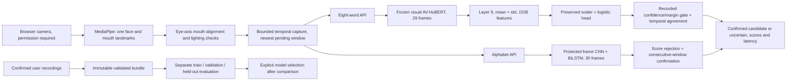

# Visual speech reliability results

Date: 2026-11-09, Asia/Calcutta. Read the [pre-change audit](RELIABILITY_AUDIT.md)
and [reproduction/API guide](RELIABILITY_REPRODUCTION.md) alongside this report.
Evidence directory: [.qa/reliability_20261109](.qa/reliability_20261109/).

**Result:** the existing eight-word encoder/head is preserved. Reliability,
rejection, API isolation, data integrity, and reproducibility were improved.
Neither BiLSTM candidate beat the pooled baseline on validation, so neither
was deployed. Full A–Z reliability and physical-webcam accuracy remain unproven.

## Architecture after the changes

Expanded 20-word, legacy four-word GRID, publisher LRW500, and experimental
Conformer/CTC paths remain separate. The default unconfigured backend still
uses the legacy four-word service; use `start_word_demo.ps1` for the evaluated
eight-word service. There is no validated continuous sentence decoder.

## Dataset findings

| Dataset | Direct inventory | Fresh checking | Limits |
|---|---|---|---|
| MIRACL words | 1,200 recordings; 8 labels; 15 speakers; 150/class | All source frames in all 1,200 recordings decoded and source hashes checked | Publisher labels, not independently relabelled |
| MIRACL phrases | 1,500 recordings; 10 phrase labels; same 15 speakers | All source frames in all 1,500 recordings decoded and source hashes checked | Separate data; never isolated-word training labels |
| GRID letter slots | 32,891 segments; 33 speakers; 25 letters | Every manifest path, speaker assignment and source-duplicate group checked; 100 source videos fully decoded | W missing; coarticulated speech; remaining videos not freshly decoded |
| Processed LRW | 45 manifest records | Inventoried separately | Development fixtures; excluded from speech-accuracy claims |

MIRACL: **0 invalid/corrupt indexed sequences**, no speaker leakage, and no
identical-source cross-split duplicates. Sequence lengths: min 4, median 11,
p95 18, max 27 source frames. Native FPS is unknown, so source durations and
native-FPS distribution are **unknown**. Never equate interpolation to 29
frames with a measured 29 FPS source.

GRID: 22,891/5,000/5,000 train/validation/test segments; label counts
1,311–1,320. No missing source paths, speaker leakage or cross-split source
hash duplicates in this manifest. The decoded 100-video sample had no
corruption; that is not a fresh full-corpus decode result. The earlier corpus
inventory excluded 109 invalid videos out of 33,000 sources.

Fresh audit outputs include per-record errors, frames, geometry, brightness,
contrast, per-class/speaker counts, and leakage reports:
[MIRACL](.qa/reliability_20261109/miracl_audit.json),
[GRID](.qa/reliability_20261109/grid_audit.json).
Full-frame brightness is not a mouth-visibility or occlusion measurement.
Per-record face/occlusion fields explicitly say `not_measured` where unmeasured.
Historical AV-HuBERT ROI preparation records 16 unusable training utterances,
leaving 704 training, 240 validation, 192 test word clips. That tracking evidence
was reused; all 2,700 sequences were not freshly landmarked in this work.

HELP, I and AM have no isolated-word examples in the eight-word corpus. Phrase
occurrences do not supply isolated-word boundaries. No examples or labels were
invented. The configurable recording intake can store genuine extra-word data;
the existing eight-word personal trainer intentionally refuses expanded
vocabulary until an explicit expanded training protocol exists.

## Controlled model comparison

Frozen layer-9 features, unchanged encoder, original train/validation speakers.
The two candidates vary only sequence length. Both use projection 64, BiLSTM
hidden 32, dropout .2, AdamW .001, batch 32, seed 42, max 25 epochs and early
stopping patience 5 on validation cross entropy. Training normalization uses
training sequences only. No test feature is opened by the experiment module.

| Model | Validation top-1 | Training time, CPU | Decision |
|---|---:|---:|---|
| Preserved mean+std logistic head | 228/240; 95.00% | Existing fitted artifact | Retain |
| Visual features + BiLSTM, 15 frames | 218/240; 90.83% | 4.39 s | Reject for deployment |
| Visual features + BiLSTM, 29 frames | 215/240; 89.58% | 4.79 s | Reject for deployment |

These training times exclude original encoder feature extraction. Candidate
best/final checkpoints, configuration, scaler, vocabulary, histories, per-class
validation metrics and confusion CSVs are in
[runs/reliability_20261109/temporal_v2](runs/reliability_20261109/temporal_v2/).
The original first attempt failed on Windows int32 targets; the explicit int64
fix and successful separate run are retained rather than erasing the failure.
No candidate test score is claimed.

Alphabet training now validates exact input geometry, requires complete
partition label coverage unless partial research is explicitly selected, and
saves best/final checkpoints, labels, preprocessing, training configuration,
seed and hashed split receipts. No new alphabet checkpoint was trained:
missing W and absent audited complete isolated A–Z recordings prevent a
credible full-alphabet experiment. Historical alphabet 12% accuracy is not
reproduced and is not used as a current benchmark.

## Frozen baseline reproduction and rejection tradeoff

After candidate selection was finished, the original frozen head was evaluated
again on its verified historical feature cache. No weights, thresholds or
candidate choices were fitted to test results. These are the same historical
192 word clips, not a new test population. Prior pilot test-speaker exposure
and the quarantine of repetitions 01–02 still limit the original protocol.

The raw result reproduces **182/192 correct, top-5 191/192, macro F1
0.9466803**. Ten errors include six `previous` errors (four to `start`), two
`next` errors, one `navigation` error and one `connection` error. The full
error list retains speaker and utterance IDs. These patterns suggest temporal
and visual ambiguity, but no human relabelling or causal diagnosis is claimed.

An important pre-existing regression was found: the policy file used .60
confidence/.10 margin despite the saved evaluation's .95/.20 gate. Its claim
of calibration for live webcam speech has no matching live validation evidence.
The file is preserved. The live service now uses the gate recorded in the
frozen evaluation and exposes the discrepancy in health.

The additional fixed rejection rule requires three overlapping 25-frame
windows of the same 29-frame encoder representation to agree and pass the
recorded gate. It uses no extra encoder forward pass. These windows share
context and **are not independent evaluation samples**. This rule is a
heuristic, not an OOV detector or calibrated confidence estimate.

| Measure | Before: current permissive file | After: recorded gate + agreement |
|---|---:|---:|
| Validation known words accepted | 224/240 | 148/240 |
| Validation accepted correct | 215/224 | 148/148 |
| Validation phrases falsely accepted | 35/60 | 5/60 |
| Historical test known words accepted | 182/192 | 123/192 |
| Historical test accepted correct | 176/182 | 123/123 |
| Historical test known-word rejection rate | 5.21% | 35.94% |
| Historical test phrases falsely accepted | 33/60; 55.00% | 5/60; 8.33% |

The stricter rule rejects many correct known words. Perfect correctness among
the accepted subset is **not** perfect speech recognition. The remaining five
phrase false accepts show that rejection remains incomplete. Unseen isolated
words, speakers, camera conditions and accents require new evaluation data.
Ten-bin raw-score ECE on the historical test is .02048; multiclass Brier score
is recorded in the JSON. Neither establishes real-world calibration.

[Final evaluation, per-class precision/recall/F1, predictions and matrix](.qa/reliability_20261109/final_frozen_evaluation.json).
Standalone CSVs are in the same evidence directory. The old evaluation and
policy files were not overwritten.

## CPU and API measurements

The controlled probe alternated the backed-up and updated services through
the **same ASGI route**, sharing one frozen encoder. It used eight genuine
validation ROI clips, JPEG quality 75. All eight raw probability vectors were
identical before/after. This measures JPEG-to-response execution; source
tracking, physical camera capture, network transport and speaking duration
are outside this benchmark.

| Metric | Original service | Reliability update, same model |
|---|---:|---:|
| Historical test raw top-1 | 94.79% | 94.79% |
| Historical test raw macro F1 | .9466803 | .9466803 |
| Average ASGI clip latency, n=8 | 464.98 ms | 444.01 ms |
| Peak process CPU memory during requests | 712.05 MiB | 711.59 MiB |
| Encoder file size | 1,240,185,329 bytes | 1,240,185,329 bytes |
| Classifier head file size | 66,488 bytes | 66,488 bytes |

The process and encoder are shared, and peak working-set counters are
cumulative; these are not independent peak-memory profiles. Eight timings
are insufficient to claim a reliable speed improvement. No quantization,
ONNX conversion or architecture enlargement was deployed.

Measured model loading plus discarded warmup: **5.75 s**. Updated ASGI p95:
**539.07 ms**. Mean stage times: JPEG/readiness 1.46 ms, normalization/resampling
7.42 ms, frozen feature extraction 427.49 ms, classification plus agreement
1.89 ms. The full response can exceed the sum because of routing and other
overhead. Three alphabet runtime probes averaged 39.20 ms on word ROI input;
those are shape/runtime checks, not alphabet recognition results.

At roughly 15 captured samples/second, a 29-frame window alone spans about
1.87 seconds. Speaking, capture, inference and confirmation all contribute to
display latency. No instant-recognition or zero-lookahead claim is made.

[Controlled CPU measurements and genuine ASGI responses](.qa/reliability_20261109/cpu_benchmark_controlled.json).
Earlier probes and failures remain available with their actual scope.

## Implementation and verification

- Personal submissions validate consent, confirmed labels, timestamp order,
  JPEG geometry, landmarker and frame hashes, duplicate decoded pixels and
  session leakage. They produce immutable bundles and HTTP 202
  `validation_required`; they never overwrite a checkpoint or activate an
  unevaluated model. Startup no longer silently substitutes `personal_words`.
- Word rejection returns `word: null` and common `prediction: null`; candidates
  remain diagnostic. Scores remain uncalibrated. Common additive response
  fields include status, task, top-k, model identity, vocabulary ID and timings.
- Alphabet display waits for consecutive accepted windows and clears rejected
  evidence. The Python buffer now locks compound operations, rejects stale
  timestamps, bounds capacity and reports oldest-frame age correctly.
- Inference uses singleton models, disabled gradients, CPU backpressure and
  bounded browser pending work. Launchers preload selected models. HTTP model
  requests have a 30-second deadline; timed-out native computation retains its
  lock until it ends, preventing a second CPU job from being queued behind it.
- Expanded data now binds derived rows to immutable source identity, checks
  duplicate IDs, binds cache keys to normalization, and verifies cached labels.
  Changed cache keys require recomputation; old cache files remain intact.
- The legacy live checkpoint uses the preserved original model definition,
  avoiding an unvalidated instance-normalization change to old weights.
- Removed unsupported SOTA/live accuracy badges and a hardcoded backend port.
  Live states, top candidates, retry, camera permission handling and separate
  tasks remain connected to backend responses.

Full regression suite including nested pipeline tests: **644 passed, 3 skipped**
(missing optional synthetic-dataset fixtures). Live frontend logic: **41 passed**;
math rendering: **26 passed**; TypeScript/Vite production build passed.
Headless Chrome: **90 checks passed**, including camera denial/unavailable/busy,
real MediaPipe on genuine replay, capture/finish/retry/next, stale responses,
timeout/failure states, navigation cleanup, twelve mobile routes and no uncaught
exceptions. API outputs in that browser test are explicit fixtures. The initial
browser attempt failed on a pre-existing hardcoded badge; its failure is saved.
Physical-camera recognition was not tested.

The initial `.venv` test run failed collection because Windows Application
Control blocked a scikit-learn DLL. The dedicated word environment initially
lacked FastAPI/PyYAML; compatible versions were installed there and the full
suite then passed. Encoder inference uses its separate existing environment.
No Windows policy was disabled. Logs, JUnit XML and environment freezes are
preserved. Tests expecting the old unsafe first-window confirmation were
updated to assert actual consecutive confirmation, not removed.

## Preservation and remaining work

**3,316 pre-existing artifact hashes checked; 0 changed, 0 missing.**
No dataset, historical checkpoint, historical evaluation or policy was deleted
or overwritten. Source snapshots, targeted rollback archive, original Git diff,
and task-only source diff are saved with the evidence.

The requested reliable full-vocabulary live recognizer is not established by
this work. Remaining requirements need genuine data/hardware work: complete
isolated A–Z recordings including W; more speakers and camera conditions;
independent unseen-word/negative examples; fresh held-out speakers after model
selection; full GRID decode and tracking/occlusion audit; physical webcam
acceptance/latency evaluation; and suitable sentence data plus a trained decoder
before continuous recognition can be supported. No cosmetic interface change,
augmentation, candidate checkpoint or fixture result substitutes for that work.
