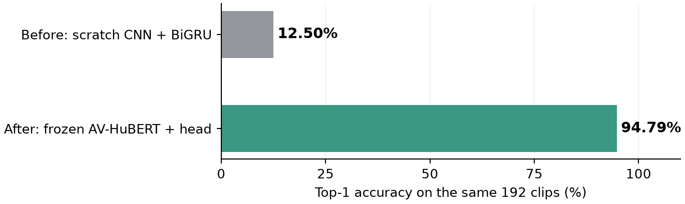
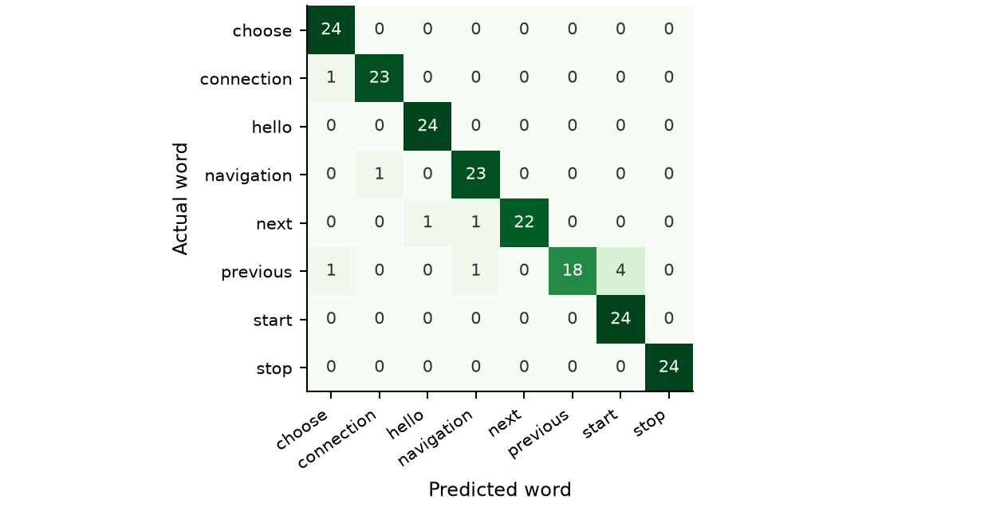

# Fine-Tuning & Model Adaptation

BEFORE AND AFTER | LipNet-AI | 30 October 2026

## Measured result: 12.50% to 94.79%

The preserved scratch word classifier correctly classified 24 of 192 clips. The new frozen AV-HuBERT encoder with a supervised eight-word classifier correctly classified 182 of those same 192 source clips: an improvement of 82.29 percentage points. [1, 2]

| Measure | Before | After |
| --- | --- | --- |
| Correct / total | 24 / 192 | 182 / 192 |
| Top-1 accuracy | 12.50% | 94.79% |
| Incorrect predictions | 168 / 192 | 10 / 192 |
| Top-5 accuracy | Not recorded in paired baseline | 191 / 192 (99.48%) |
| Output vocabulary | Same eight words | Same eight words |

## What was actually trained

This was supervised classifier-head training on frozen pretrained features (transfer learning / linear probing). AV-HuBERT encoder weights were not fine-tuned. The comparison replaces the feature extractor and changes preprocessing and training-data volume; it does not isolate the effect of one fine-tuning step.

## Scope

Silent isolated-word recognition using MIRACL-VC1 RGB recordings: choose, connection, hello, navigation, next, previous, start, stop. The 94.79% figure belongs only to this eight-word offline experiment. It is not a 500-word LRW, sentence-recognition, or physical-webcam accuracy result.

Experiment recorded: 29 October 2026. Report prepared from existing artifacts on 30 October 2026. No new training or recognition experiment was run to create this document.

---

# Architecture and training changes

What changed between the two systems

| Component | Before: preserved scratch model | After: pretrained features + head |
| --- | --- | --- |
| Feature extractor | Three Conv3D blocks; channels 8, 16, 32; GroupNorm and SiLU | Official AV-HuBERT Base encoder; weights frozen |
| Temporal processing | Two-layer bidirectional GRU; hidden size 48 per direction | Transformer layer 9 features; temporal mean + standard deviation |
| Classifier input | 96-dimensional pooled GRU representation | 1,536-dimensional pooled encoder representation |
| Output | Dropout 0.15 and linear eight-class layer | Training-fitted StandardScaler and eight-class logistic classifier |
| Tensor format | [B, 1, 24, 64, 64] grayscale | [B, 1, 29, 88, 88] grayscale |
| Scaling | Pixels divided by 255 | Pixels / 255, then (x - 0.421) / 0.165 |

## Frozen-feature head fitting [3, 4, 7]

Measured landmarks align the eye axis and mouth center. The sequence uses a 96 x 96 mouth crop, linear interpolation to 29 frames, and an 88 x 88 center crop. Layers 6, 9 and 12 were cached together as [3, 29, 768] features. Native MIRACL FPS is unknown; interpolation does not establish a frame rate.

The search tested 3 layers x 3 pooling choices (mean, three temporal means, mean/std) x 3 regularization values C = 0.01, 0.1, 1.0: 27 candidates. Selection used highest validation accuracy, breaking ties with lower validation cross-entropy. The scaler was fitted on training features only.

Winner: layer 9, mean/std pooling, C = 1.0; L-BFGS logistic regression, class_weight='balanced', random_state=42, max_iter=600. The selected fit recorded 11 solver iterations, not 11 epochs. It has 8 x 1,536 + 8 = 12,296 classifier coefficients/biases, plus stored scaler statistics.

## Baseline training context [5, 6]

The baseline log records 12 epochs with best epoch 11 selected by validation loss, batch size 2, seed 42 and one CPU thread. Its two-repetition protocol planned 144 training clips and retained 140 rows. The new head used 704 usable training clips from repetitions 1-10. Training volume and model selection differ; this is a system comparison, not a controlled equal-data architecture ablation.

---

# Dataset and evaluation protocol

Real inputs, fixed splits and selection boundaries

| Partition | Speakers | Known-word clips |
| --- | --- | --- |
| Training | F01, F02, F04, F05, F06, F07, M01, M02, M04 | 720 planned; 704 usable |
| Validation | F08, F09, M07 | 240 / 240 usable |
| Test | F10, F11, M08 | 192 / 192 usable; 24 per word |
| Phrase diagnostics | Separate validation / test phrase sets | 60 validation + 60 test; not word-training labels |

## Evaluation safeguards [1-4]

Training, validation and test speakers do not overlap. Test utterances are repetitions 03-10 from F10, F11 and M08. The 48 repetitions 01-02 used by the earlier pilot were explicitly quarantined. Those test speakers had been observed in the pilot: these are fresh utterances on the original held-out speakers, not a completely untouched new speaker population.

Head and feature choices used word validation results, with selection.json explicitly recording test_used=false. Test predictions were evaluated after selection. Existing selected heads and evaluation outputs are protected from accidental overwrite. Tracking failures are explicit; evaluation failures count as errors rather than disappearing from the denominator.

For the paired result, both systems received the same 192 source IDs and original RGB recordings. Each used its own actual trained spatial and temporal preprocessing. The old model was not evaluated on downscaled AV-HuBERT feature-cache inputs. [1, 7]

## Measured CPU work [3, 8]

| Stage | Recorded time | Work represented |
| --- | --- | --- |
| Tracking / preparation | 626.28 s | 1,272 planned word/phrase clips; 1,256 usable |
| Frozen feature extraction | 856.29 s | 1,256 encoded word/phrase clips |
| 27-head search and fitting | 19.29 s | Training and validation selection |
| Paired baseline comparison | 52.03 s | 192 original RGB test clips |

Execution was recorded on the existing Windows CPU environment (Intel i3-1115G4; no CUDA). These times have different workloads and exclude some setup/loading work. They are neither an equal-work speed comparison nor a real-time webcam latency guarantee.

---

# Per-word results and confusion

Same 192 test source clips | raw top-1 before rejection

| Word | Before correct | After correct | After accuracy | After F1 |
| --- | --- | --- | --- | --- |
| choose | 24 / 24 | 24 / 24 | 100.00% | 0.9600 |
| connection | 0 / 24 | 23 / 24 | 95.83% | 0.9583 |
| hello | 0 / 24 | 24 / 24 | 100.00% | 0.9796 |
| navigation | 0 / 24 | 23 / 24 | 95.83% | 0.9388 |
| next | 0 / 24 | 22 / 24 | 91.67% | 0.9565 |
| previous | 0 / 24 | 18 / 24 | 75.00% | 0.8571 |
| start | 0 / 24 | 24 / 24 | 100.00% | 0.9231 |
| stop | 0 / 24 | 24 / 24 | 100.00% | 1.0000 |

Rows are actual labels; columns are predictions. Four 'previous' clips were classified as 'start'. The remaining six errors were connection->choose (1), navigation->connection (1), next->hello (1), next->navigation (1), previous->choose (1), previous->navigation (1). [2]

After-model macro F1: 0.94668. Single-word substitution error: 10/192 = 5.21% (not sentence WER). By speaker: F10 62/64 (96.88%); F11 57/64 (89.06%); M08 63/64 (98.44%). On paired clips, 158 baseline errors became correct and no baseline-correct clips became incorrect. [1, 2]

---

# Interpretation and current limits

Keep offline accuracy separate from live acceptance

## Raw accuracy and rejection answer different questions

The 94.79% result counts every known test word before uncertainty rejection. The frozen evaluation also records confidence >= 0.95 and margin >= 0.20: 137/192 known words accepted (71.35% coverage), all 137 accepted words correct, and 55 rejected. The same policy falsely accepted 8/60 test phrases (13.33%). Accepted accuracy is conditional on rejection and must not be presented as 100% overall recognition. [2]

## Configuration drift found while preparing this report

The current rejection_policy.json contains threshold 0.60 and margin 0.10, while evaluation.json records 0.95 and 0.20. The saved 137/192 acceptance and 8/60 phrase results therefore apply to the evaluated historical policy only; they cannot be assigned to the current configuration. Its claim of webcam calibration is not established by these offline artifacts. This report records the difference without changing the file. [2, 9]

## What the evidence supports

The new complete eight-word system performs substantially better than the preserved scratch system on the specified paired clips. A richer pretrained representation is a plausible contributor, but data volume, preprocessing and selection also changed. No equal-data ablation establishes their separate causal contributions.

A saved real API smoke accepted a labeled 'connection' clip at confidence 0.99838. This verifies one actual request path; confidence is not an accuracy estimate. No fresh API inference was run for this report. [10]

## Boundaries and next experiments

Physical webcam accuracy, new cameras/lighting, unseen isolated words and unrestricted English remain unmeasured. GRID letter-slot training and the independent publisher-trained LRW 500-word model are separate experiments; neither inherits this eight-word score. No verified visual-only sentence decoder is established by these results.

A defensible next study would freeze the acceptance policy, collect genuinely new speakers and webcam clips, compare both systems on equal training data, and evaluate once on a fresh held-out test set. True encoder fine-tuning would require a separate run with explicit unfrozen layers and optimization logs; it was not performed here.

---

# Evidence and reproducibility

Repository-relative evidence | report generation is read-only for model artifacts

[1] Paired source-matched comparison: runs/word_accuracy/avhubert_miracl8_v1/paired_comparison.json

[2] Frozen test metrics and confusion matrix: runs/word_accuracy/avhubert_miracl8_v1/evaluation.json

[3] 27 candidates and selected hyperparameters: runs/word_accuracy/avhubert_miracl8_v1/selection.json

[4] Vocabulary, preprocessing and quarantine: runs/word_accuracy/avhubert_miracl8_v1/protocol.json

[5] Preserved scratch architecture: pipeline/word_recognition/legacy_word_model.py

[6] Baseline training log, contract and selected rows: runs/multidataset/miracl8_cpu_v2/{training.json,contract.json,selected.jsonl,split_inventory.json}

[7] Fitting and source-matched evaluation code: pipeline/word_recognition/pretrained.py; scripts/compare_word_accuracy.py

[8] Measured preparation and extraction: runs/word_accuracy/avhubert_miracl8_v1/{preparation.json,extraction.json}

[9] Current acceptance configuration: runs/word_accuracy/avhubert_miracl8_v1/rejection_policy.json

[10] Historical real API smoke: .qa/word-improvement-real-api.json

## Artifact identities (SHA-256)

Preserved scratch best.pt: 3c7c420d30ac111d4b752322318d92c3b9dfa2077ba2f3d04bc6a71b6aa937ed

Trained eight-word head.pt: bc07a9eca0979e556af573a387733396a891fe41faa10715c9f4d323e9c4cc74

Frozen encoder (recorded by protocol): dee8b0651dbea3a21cda0f2c52b956e3a878d5f6ee503d427d6a4044bb95c9cc

The builder rechecks the two classifier checkpoint hashes, legacy source hash, feature-manifest hash, paired test IDs, quarantine exclusion, confusion counts, top-5 count and disjoint speaker assignments. It reads predictions and logs without loading either neural network or modifying checkpoints. The large encoder hash above is from the recorded protocol, not a fresh rehash.

Rebuild document only: .\.venv\Scripts\python.exe scripts/build_finetuning_comparison.py

Outputs: PDF, editable DOCX, Markdown, two PNG figures and a document-validation receipt. Existing submission documents, frontend work, model selection and running servers are preserved. No new model accuracy is claimed by report generation.
